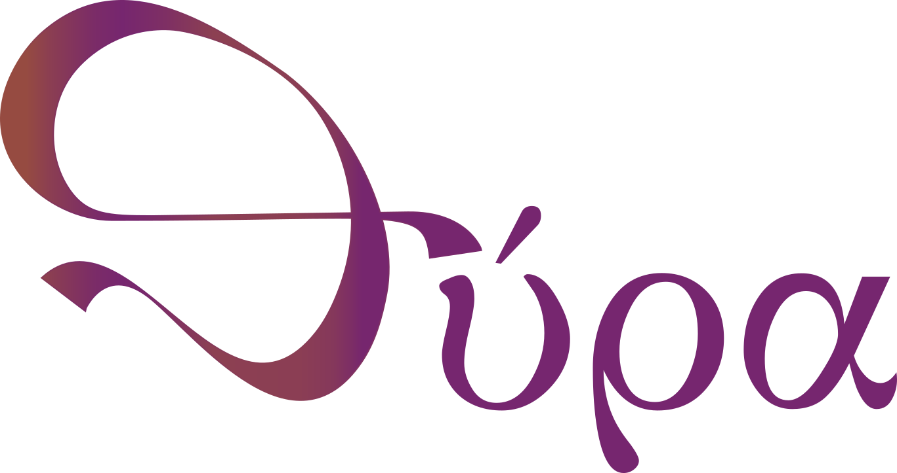
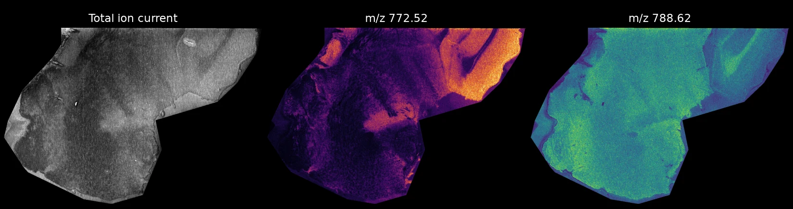

<p align="center">
  
</p>

[](https://github.com/M4i-Imaging-Mass-Spectrometry/thyra/actions/workflows/tests.yml)
[](https://pypi.org/project/thyra/)
[](https://www.python.org/downloads/)
[](https://opensource.org/licenses/MIT)
[](https://github.com/psf/black)
[](https://M4i-Imaging-Mass-Spectrometry.github.io/thyra)
[](https://colab.research.google.com/github/M4i-Imaging-Mass-Spectrometry/thyra/blob/main/notebooks/Thyra_Validation_Workflow.ipynb)

**Thyra converts imaging mass spectrometry data into one open format.** It
reads the files your instrument writes (Bruker, Waters, PHI, or imzML from any
vendor) and saves them in [SpatialData](https://spatialdata.scverse.org/),
which analysis and viewing tools can read. It keeps ion mobility (TIMS 1/K0)
and MS/MS (PASEF, iprm-PASEF) data, not only the spectra. You do not need to
know how to program.

**[Documentation](https://M4i-Imaging-Mass-Spectrometry.github.io/thyra)** | [Install](https://M4i-Imaging-Mass-Spectrometry.github.io/thyra/install/) | [Your first conversion](https://M4i-Imaging-Mass-Spectrometry.github.io/thyra/getting-started/) | [Tutorial](https://M4i-Imaging-Mass-Spectrometry.github.io/thyra/tutorial/) | [Technical reference](https://M4i-Imaging-Mass-Spectrometry.github.io/thyra/technical-reference/)



<sub>A sagittal mouse brain section converted with Thyra: the total ion current
and two ion images. MALDI-MSI data from
[10.5281/zenodo.18326569](https://doi.org/10.5281/zenodo.18326569),
CC-BY-4.0.</sub>

## Quick start

```bash
uv tool install --python 3.13 thyra                     # or: pip install thyra (Python 3.12 to 3.14)
thyra-example-data example_data/synthetic_brain.imzML   # makes a small example dataset
thyra example_data/synthetic_brain.imzML example_data/synthetic_brain.zarr
```

New to the terminal or to uv? The
[Install](https://M4i-Imaging-Mass-Spectrometry.github.io/thyra/install/) page
walks you through every step. To try Thyra with nothing installed, open the
[notebook in Google Colab](https://colab.research.google.com/github/M4i-Imaging-Mass-Spectrometry/thyra/blob/main/notebooks/Thyra_Validation_Workflow.ipynb).
The [Tutorial](https://M4i-Imaging-Mass-Spectrometry.github.io/thyra/tutorial/)
also converts the published example dataset
([10.5281/zenodo.18326569](https://doi.org/10.5281/zenodo.18326569)).

## What you can convert

| Your instrument | Point Thyra at |
|---|---|
| Bruker timsTOF or solariX | the folder ending in `.d` |
| Bruker rapifleX | the acquisition folder |
| Waters (MassLynx) | the folder ending in `.raw` |
| PHI nanoTOF (ToF-SIMS) | the file ending in `.raw` |
| Any instrument that exports imzML | the `.imzML` file, with its `.ibd` file next to it |
| mzPeak (experimental) | the `.mzpeak` file |

imzML with a mobility array is read too. In continuous mode, as TIMSImaging
writes it, the mobility is kept as its own table. In processed mode, as
TIMSCONVERT writes it, add `--mobility-grid` for that table.

Thyra reads timsTOF and Waters data on Windows and Linux; everything else
also works on macOS. Shimadzu support is in development: until then, export
imzML from IMAGEREVEAL MS.

PHI mosaic, MS/MS and depth-profiling acquisitions have so far been tested
only on synthetic files. If you have real data in those modes, please get in
touch.

## What you get

One folder ending in `.zarr`, holding:

- the spectrum of every pixel, on one shared m/z axis
- an image of the total ion current (TIC)
- the optical image of the slide, when the acquisition has one
- ion mobility and MS/MS data, when the acquisition has them (below)
- a validated description of the acquisition, ready for METASPACE

Thyra handles datasets larger than your computer's memory, slides with
several regions, and 3D data.

## Ion mobility and MS/MS

Thyra keeps the extra dimensions of Bruker timsTOF data instead of dropping
them.

- **By default** each spectrum is added up over mobility, so every tool can
  read the main table. The table also carries a mass-mobility heatmap of the
  whole image, `uns["mobility_heatmap"]`.
- **`{table}_mobility`** has one column for each (m/z, 1/K0) pair. It is
  written by itself from continuous imzML with a mobility array, and from
  Bruker TDF and processed imzML with `--mobility-grid`. `var["ccs"]`
  holds each pair's collision cross section (CCS) in square angstroms, for
  an assumed charge of 1; `uns["ccs"]` records the assumptions.
- **`{table}_msms`** splits PASEF and iprm-PASEF MS/MS by precursor: one
  block of fragment columns per precursor, so every fragment has its own
  image.

Two ions at one m/z, told apart by mobility:

```python
import numpy as np
import spatialdata as sd

sdata = sd.read_zarr("output/sample.zarr")
mob = sdata.tables["msi_dataset_z0_mobility"]
mz, k0 = mob.var["mz"].to_numpy(), mob.var["mobility"].to_numpy()
near = np.abs(mz - 600.25) < 0.01
low = np.asarray(mob.X[:, near & (k0 < 1.3)].sum(axis=1)).ravel()   # one value per pixel
high = np.asarray(mob.X[:, near & (k0 >= 1.3)].sum(axis=1)).ravel()
```

Tools should recognise these tables by their columns (`"mobility" in
var.columns`, `"precursor_mz" in var.columns`), not by their names. The
[Ion mobility and MS/MS guide](https://M4i-Imaging-Mass-Spectrometry.github.io/thyra/ion-mobility-and-msms/)
walks through both, and the output format describes the
[mobility](https://M4i-Imaging-Mass-Spectrometry.github.io/thyra/output-format/#ion-mobility)
and [MS/MS](https://M4i-Imaging-Mass-Spectrometry.github.io/thyra/output-format/#demultiplexed-msms-table)
tables in full.
[For tool developers](https://M4i-Imaging-Mass-Spectrometry.github.io/thyra/for-tool-developers/)
lists the rules a tool can rely on, and what may change.

Not covered yet: Waters ion mobility (drift time) functions are skipped.
CCS is computed from 1/K0 only, never from a drift time.

## From Python

```python
from thyra import convert_msi
import spatialdata as sd

convert_msi("data/sample.imzML", "output/sample.zarr")

sdata = sd.read_zarr("output/sample.zarr")
table = sdata.tables["msi_dataset_z0"]  # one row per pixel, one column per m/z bin
```

The acquisition description has its own commands:

```bash
thyra metadata raw_data.d                                # describe a dataset without converting it
thyra validate output.zarr                               # check a result against the schema
thyra export-metaspace output.zarr --merge sample.json   # METASPACE submission file
```

Every option, format and output detail is in the
[Technical reference](https://M4i-Imaging-Mass-Spectrometry.github.io/thyra/technical-reference/).

## Development

```bash
git clone https://github.com/M4i-Imaging-Mass-Spectrometry/thyra.git
cd thyra
uv sync
uv run pre-commit install
uv run pytest
```

CI runs the same hooks on every pull request. Installing them locally shows
you a failure before you push.

## Contributing

See [CONTRIBUTING.md](docs/contributing.md) for guidelines.

## License

MIT -- see [LICENSE](LICENSE).

## Citation

If you use Thyra, please cite the paper:

> Visvikis, T.; Vierdag, W.-M.; Marconato, L.; Birmpili, A.; Heeren, R. M. A.;
> Cuypers, E. Native, Memory-Bounded Conversion of Mass Spectrometry Imaging
> Data into the SpatialData Ecosystem. *J. Am. Soc. Mass Spectrom.* **2026**,
> *37* (10), 2379-2387.
> [doi:10.1021/jasms.6c00169](https://doi.org/10.1021/jasms.6c00169)

```bibtex
@article{visvikis2026thyra,
  title   = {Native, Memory-Bounded Conversion of Mass Spectrometry Imaging Data into the {SpatialData} Ecosystem},
  author  = {Visvikis, Theodoros and Vierdag, Wouter-Michiel and Marconato, Luca and Birmpili, Angeliki and Heeren, Ron M. A. and Cuypers, Eva},
  journal = {Journal of the American Society for Mass Spectrometry},
  year    = {2026},
  volume  = {37},
  number  = {10},
  pages   = {2379--2387},
  doi     = {10.1021/jasms.6c00169}
}
```

The same entry is in [CITATION.cff](CITATION.cff), which GitHub's "Cite this
repository" button reads. To cite the software itself:

```bibtex
@software{thyra2024,
  title = {Thyra: Modern Mass Spectrometry Imaging Data Conversion},
  author = {Visvikis, Theodoros},
  year = {2024},
  url = {https://github.com/M4i-Imaging-Mass-Spectrometry/thyra}
}
```

### Papers

| Paper | Published | DOI |
|---|---|---|
| Native, Memory-Bounded Conversion of Mass Spectrometry Imaging Data into the SpatialData Ecosystem (*J. Am. Soc. Mass Spectrom.*) | 2026-09 | [10.1021/jasms.6c00169](https://doi.org/10.1021/jasms.6c00169) |
| Thyra: Bridging Mass Spectrometry Imaging and SpatialData for Unified Multi-Modal Analysis (bioRxiv preprint) | 2026-01 | [10.64898/2026.01.26.700792](https://doi.org/10.64898/2026.01.26.700792) |

Ion mobility and MS/MS support came after both papers. If you use them,
please also name the Thyra version you used.

## Acknowledgments

- Built with [SpatialData](https://spatialdata.scverse.org/) ecosystem
- Powered by [Zarr](https://zarr.readthedocs.io/) for efficient storage
- Uses [pyimzML](https://github.com/alexandrovteam/pyimzML) for ImzML parsing

### Visual identity

Logomark and logotype designed by **Nepsis Scriptorium**.

[](https://www.instagram.com/nepsis.scriptorium/)
[](mailto:nepsisscriptorium@gmail.com)
